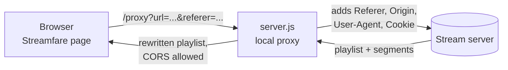

<div align="center">



<br>


**Paste a link. Add the headers it needs. Watch.**

[Quick start](#-quick-start) ·
[Features](#-features) ·
[How it works](#-how-it-works) ·
[Customize](#-customize) ·
[Troubleshooting](#-troubleshooting)

</div>

---

## ✨ Features

| | |
|---|---|
| 🎬 **Real player** | HLS (`.m3u8`), MPEG-TS, FLV and plain MP4 through hls.js and mpegts.js |
| 🧩 **Headers on demand** | Referer, Origin, User-Agent, Cookie and Authorization are typed in right on the page |
| 🔗 **Smart link paste** | Understands `url\|Referer=...&Origin=...` links and fills the fields for you |
| 🔴 **LIVE button** | Jumps to the live edge, and turns grey when you fall behind |
| 🎛️ **Full controls** | Quality, volume, brightness, contrast, saturation, speed and fit |
| 🌗 **Dark and light** | Remembers your theme, follows your system the first time |
| 🪟 **Glass UI** | Smooth animations built to stay fluid on 120 and 144 Hz screens |
| 💾 **Remembers you** | Last link and headers are saved in your browser only |

## 🚀 Quick start

You need [Node.js](https://nodejs.org) 18 or newer. There is nothing to install.

```bash
git clone https://github.com/YOUR-USERNAME/streamfare.git
cd streamfare
node server.js
```

Then open **http://localhost:3000**.

> [!IMPORTANT]
> Always open the page through that address. Double-clicking `index.html` or using
> a "Live Server" extension will not work, because the page needs the local server.

### Using it

1. Open **Stream source** and paste your link.
2. Fill in Referer and Origin if the stream needs them (use the website that normally plays it).
3. Press **Load stream**. The panel folds away once the video starts.

**Link formats it accepts**

```text
https://example.com/live/index.m3u8
https://example.com/live/index.m3u8|Referer=https://example.com/&Origin=https://example.com
```

## 🧠 How it works

Browsers are not allowed to set headers like `Referer` and `Origin`, and many stream
servers also block cross-origin requests. Streamfare solves both with a tiny local proxy.



For HLS the proxy also rewrites the playlist so every video segment and key goes
through it with the same headers. If the playlist link carries an Akamai `hdnea`
token, it is copied onto segments that have none.

## ⌨️ Controls

| Action | Button | Key |
|---|---|---|
| Play / pause | player bar | `Space` |
| Jump to live | **LIVE** | `L` |
| Mute | **Mute** | `M` |
| Fullscreen | **Fullscreen** | `F` |
| Volume | slider | `↑` `↓` |
| Picture-in-picture | **PiP** | |

## 📁 Project layout

```text
streamfare/
├── server.js              static server + /proxy
├── package.json
├── assets/
│   └── banner.svg
└── public/
    ├── index.html         page markup only
    ├── css/
    │   └── style.css      all styling, theme values are variables at the top
    └── js/
        ├── main.js        connects the form, player and UI
        ├── player.js      StreamPlayer class (HLS, MPEG-TS/FLV, native)
        ├── controls.js    volume, picture filters, buttons, shortcuts
        ├── select.js      glass dropdown that replaces native menus
        ├── link.js        link parsing and proxy URLs
        ├── ui.js          status pill, theme, collapsible card
        └── storage.js     localStorage wrapper
```

## 🎨 Customize

Most changes are one small edit. Everything below lives in `public/css/style.css` unless noted.

| I want to... | Change |
|---|---|
| Different accent color | `--accent` and `--accent2` near the top |
| More solid dropdown panels | `--glass-opacity` (higher = more solid) |
| Stronger frosted blur on dropdowns | `--glass-blur` |
| Change the port | `PORT` in `server.js` |
| Support another stream format | add a case in `StreamPlayer.load()` in `js/player.js` |
| Send another header | add it to `FORWARDED_HEADERS` in `server.js`, `HEADER_FIELDS` in `js/link.js`, and an input in `index.html` |

## 🛠️ Troubleshooting

| What you see | Likely cause and fix |
|---|---|
| `manifestParsingError` | The server did not return a playlist. Check Referer and Origin, and that the page is opened at `localhost:3000` |
| Terminal prints `Upstream 403` | Stream server rejected the headers. Copy Referer and Origin from the browser's Network tab (F12) while the original site plays it |
| `Upstream 401`, `404` or `410` | The link or its token expired. Get a fresh link |
| `EADDRINUSE` | Port 3000 is taken. Stop the old server with `Ctrl+C` or change `PORT` |
| Page is unstyled or buttons do nothing | Opened by double-click. Run `node server.js` and open `http://localhost:3000` |
| Control icons not white | The icon styling works in Chrome and Edge only |
| Choppy animation on a fast screen | Turn on hardware acceleration in your browser and check the OS refresh rate |

## ⚖️ Notes

- Streamfare is **only a player**. It contains no channels or links, and you supply your own.
- Use it only with streams you have the right to watch.
- DRM-protected streams (Widevine and similar) are not supported, and it does not bypass any protection.
- Tokenized links expire. A dead link needs a new one.
- The proxy is meant for **your own computer**. Do not expose it to the internet, because it will fetch any address it is given.

<div align="center">

<sub>Built with plain HTML, CSS and JavaScript · hls.js · mpegts.js</sub>

</div>